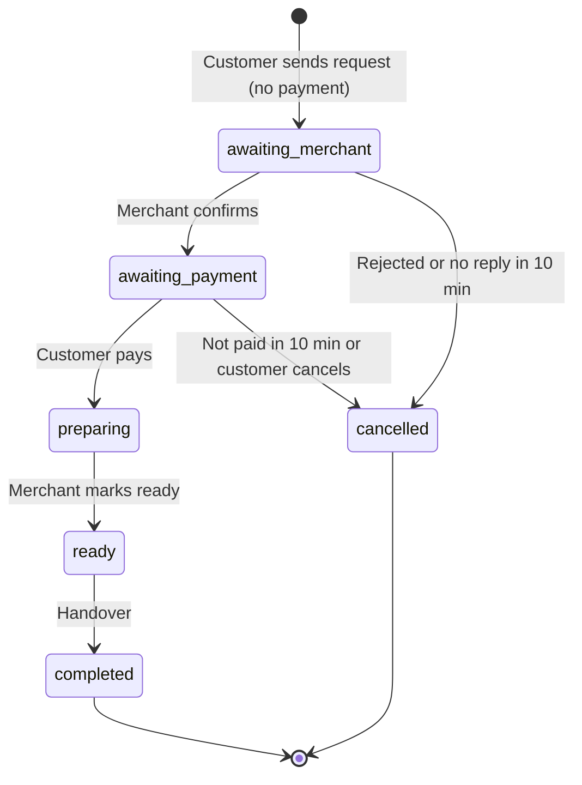

# ScootMeal - Food Ordering Platform

A food ordering platform for students and campus stalls. It connects **customers**, **merchants** (restaurants and stalls) and **platform admins**. Built as a Final Year Project (COS40005) for **Quest Marketing**.

The platform has three front-end applications that share one backend:

| Part | Folder | Used by |
|---|---|---|
| Customer App (Expo / React Native) | `apps/customer-app` | Customers (iOS, Android, web) |
| Merchant App (Expo / React Native) | `apps/merchant-app` | Restaurants and stalls (iOS, Android, web) |
| Web Admin (React + Vite) | `apps/web-admin` | Platform administrators (browser) |
| Backend API (Node.js + TypeScript + Express) | `backend` | All three apps |

---

## Client and Supervisor

| Role | Name |
|---|---|
| Client | Mr. Felix Ling, Quest Marketing |
| Supervisor | Dr. Sim Kwan Hua |

## Team and ownership

Each person owns their own folders. Please do not edit another person's folder directly. Ask in the group chat or send a pull request.

| Member | Area | Main folders |
|---|---|---|
| Nathan | Customer app UI, Figma prototype, merchant sign-up screens | customer app: `discovery`, `account`, `auth`, `favourites`, `loyalty`, `jobs`, `notifications`, `dine-in`; merchant app: `onboarding`, `menu`, `promotions`, `analytics`, `jobs`, `auth` |
| Badrul | Order flow, chat, voice calls, web admin, tests, client documents | customer app: `ordering`, `payment`, `chat`, `calls`; merchant app: `orders`, `dashboard`, `reservations`, `chat`, `calls`; `apps/web-admin`; backend: `ordering`, `payment`, `chat`, `calls`, `delivery` |
| Michael | Backend, customer side (users, discovery) and the database setup | backend: `auth`, `notifications`, discovery and database code |
| David (Nai Cong Yek) | Backend and merchant side (shop sign-up, menu, reservations, admin) | backend: `merchants`, `dine-in`, `admin`, menu and uploads |
| Harris | AI assistant | backend: `ai-assistant`; customer app: `ai-assistant` |

---

## What works now

- **Sign-in and roles:** customer, merchant and admin accounts. Merchants register and wait for admin approval.
- **Confirm-then-pay order flow:** the customer sends an order request with **no payment**. The merchant gets a full-screen pop-up and has 10 minutes to confirm or reject. The customer pays only after the merchant confirms, and has 10 minutes to pay. See the diagram below.
- **Out-of-stock handling:** the merchant marks an item out of stock and the customer chooses to continue or cancel. Refunds are automatic.
- **Live chat** between customer and merchant (before payment, in the pop-up, the order queue and the order screen).
- **In-app voice calls** (WebRTC): ring, accept, decline, mute, end, missed-call handling, and call history in the chat.
- **Table reservations** with a pre-order and a booking deposit.
- **Merchant sign-up flow** with shop details, then admin approval.
- **AI assistant:** OpenAI called from the backend. It reads the menu, vouchers and the user's own orders on the server, and has an offline fallback when the AI is not available.
- **Web admin:** pages and layout are built, but they still show sample data. The backend already has the merchant approve and reject endpoints.
- **Tests:** a backend smoke test and a browser end-to-end test.

### Order lifecycle



Nothing is charged for a request that is rejected, not answered, not paid or cancelled.

---

## Tech Stack

| Layer | Technology | Status |
|---|---|---|
| Mobile apps | Expo SDK 57 / React Native, TypeScript | In use |
| Web admin | React + Vite, TypeScript | In use |
| Backend | Node.js, Express 5, TypeScript | In use |
| Database | In-memory demo store now. **Supabase** (Postgres and file storage for pictures) is being added | In progress |
| Payments | Simulated Stripe (test card only, no real money) | Simulated |
| Delivery and GPS | Simulated rider movement. Lalamove or PandaGo planned | Paused |
| Chat and calls | Polling (about 2 s) for chat. WebRTC for calls, with STUN only. The backend only passes the call setup messages | In use |
| AI assistant | OpenAI, called from the backend | In use |

---

## Repository structure

Each app and the backend are split into **modules** (one folder per feature), so teammates can work in different folders without clashing.

```
FYP-FoodOrderingPlatform/
├── apps/
│   ├── customer-app/        Expo app for customers
│   │   └── src/
│   │       ├── navigation/  root navigator, home tabs
│   │       ├── modules/     auth, discovery, ordering, dine-in, delivery, payment,
│   │       │                loyalty, favourites, jobs, notifications, chat, calls,
│   │       │                ai-assistant, account
│   │       └── shared/      api, components, theme, voice, util, mock data, config
│   ├── merchant-app/        Expo app for merchants
│   │   └── src/
│   │       ├── navigation/
│   │       ├── modules/     auth, onboarding, dashboard, orders, reservations, menu,
│   │       │                promotions, analytics, jobs, notifications, chat, calls
│   │       └── shared/
│   └── web-admin/           React + Vite admin dashboard
│       └── src/
│           ├── app/         routes and layout
│           ├── modules/     auth, dashboard, merchants, users, orders,
│           │                disputes, moderation, analytics
│           └── shared/
├── backend/                 Node + TypeScript + Express API
│   ├── src/
│   │   ├── app.ts, server.ts
│   │   ├── config/          environment settings
│   │   ├── middleware/      auth, error handling
│   │   ├── modules/         auth, merchants, ordering, dine-in, payment, delivery,
│   │   │                    chat, calls, notifications, ai-assistant, admin
│   │   ├── store/           data store (in-memory now, moving to Supabase)
│   │   └── jobs/            timers for order and reservation deadlines
│   └── tests/               smoke.mjs
├── database/                migrations and seed data
└── docs/                    requirements, diagrams, planning, meeting notes, admin forms
```

Modules with the same name in the apps and the backend belong together. For example, ordering is in `apps/customer-app/src/modules/ordering` and `backend/src/modules/ordering`.

---

## Getting Started

**You need:** Node.js **22.13 or newer** and Git.

```bash
git clone https://github.com/bettozky/FYP-FoodOrderingPlatform.git
cd FYP-FoodOrderingPlatform
```

Use `npm ci` (not `npm install`) so everyone gets the same package versions. Run it again after every `git pull`.

**1. Backend** (copy `backend/.env.example` to `backend/.env` first)
```bash
cd backend
npm ci
npm run dev          # http://localhost:3001
```

**2. Customer App**
```bash
cd apps/customer-app
npm ci
npm run web          # fastest check. Or: npm start (Expo Go), npm run android
```

**3. Merchant App**
```bash
cd apps/merchant-app
npm ci
npm run web
```

**4. Web Admin**
```bash
cd apps/web-admin
npm ci
npm run dev          # usually http://localhost:5173
```

### Using a real phone

A phone cannot reach `localhost` on your PC. Use your PC's Wi-Fi IP address (run `ipconfig` on Windows), and put the phone and PC on the same network.

```bash
# macOS / Linux
EXPO_PUBLIC_API_URL=http://192.168.x.x:3001 npx expo start -c
```
```powershell
# Windows PowerShell
$env:EXPO_PUBLIC_API_URL="http://192.168.x.x:3001"
npx expo start -c
```

If the phone cannot connect, check Windows Firewall (allow port 3001) or try a phone hotspot. Voice calls on phones need a development build, because Expo Go only supports chat.

### Demo accounts (test data only)

| Role | Email | Password |
|---|---|---|
| Customer | `demo@scootmeal.test` | `demo123` |
| Merchant | `ahseng@scootmeal.test` | `merchant123` |
| Admin | `admin@scootmeal.test` | `admin123` |

New merchants stay "pending" until an admin approves them. Test card: `4242 4242 4242 4242` succeeds, `4000 0000 0000 0002` is declined.

### Short timers for demos

The default timers are 10 minutes. To speed up a demo, start the backend with shorter values (in milliseconds):

```bash
ORDER_RESPONSE_MS=40000 PAYMENT_WINDOW_MS=40000 CALL_RING_MS=15000 npm run dev
```

### Tests

With the backend running:
```bash
cd backend
API_URL=http://localhost:3001 node tests/smoke.mjs
```
Type check any folder with `npx tsc --noEmit` (or `npm run typecheck` in the backend and web admin).

### Common problems

| Problem | Fix |
|---|---|
| Errors like `expo/internal/bundle-origin` or a missing package | Run `npm ci` in that folder. **Do not run** `npx expo install --fix`. |
| Red error in `tsconfig.json` | `node_modules` is missing. Run `npm ci`, then restart the TypeScript server in your editor. |
| `.expo` or log files appear in GitHub Desktop | Do not commit them. Discard them or ignore the folder. |
| App cannot reach the backend on a phone | Use your PC's IP, not `localhost`. See "Using a real phone". |

Never commit `.env` files, API keys, `node_modules` or `.expo`.

---

## Branching and teamwork

- `main` is stable and always works. Nobody pushes straight to `main`.
- Each person works on their own branch, for example `feat/nathan-discovery`, `feat/david-merchant`, `feat/harris-ai`.
- Open a **pull request** into `main`. Keep pull requests small and merge at least once a day.
- Pull from `main` every morning, then run `npm ci`.
- Edit only your own folders (see "Team and ownership"). To change a shared file, ask its owner.
- Agree the request and response of a new endpoint in the group chat before building it.

```bash
git checkout main
git pull
git checkout -b feat/your-task-name
# ...make changes...
git add <your files>
git commit -m "Describe your change"
git push -u origin feat/your-task-name
```

---

## Project Status

- [x] Project brief reviewed, repository set up
- [x] Client meetings (15 Oct 2026) and process flow in the client's Mytec layout
- [x] Customer, merchant and admin sign-in, merchant approval
- [x] Confirm-then-pay order flow, out-of-stock handling, refunds
- [x] Live chat and in-app voice calls
- [x] Table reservations
- [x] Merchant sign-up flow
- [x] AI assistant with server-side data and offline fallback
- [x] Automated tests (smoke and browser end-to-end)
- [ ] Supabase database and real picture storage (in progress)
- [ ] Web admin connected to the backend (pages built, still using sample data)
- [ ] Figma interactive prototype for the client
- [ ] Colour and layout clean-up in both apps
- [ ] Confirm-then-pay for table reservations
- [ ] Delivery and GPS (paused; Lalamove or PandaGo sandbox needed)
- [ ] POS entry and "Send to Kitchen" steps (waiting for the client's decision)

### Known limits

- Payment and delivery are simulated. No real money or riders.
- The demo data is in memory and resets when the backend restarts, until Supabase is connected.
- Chat and calls use polling and STUN only, so calls may fail on strict networks (a TURN server is needed for that).
- Chat messages and calls are for the prototype only. A privacy notice, retention rule and abuse reporting are needed before real users.

---

## Documentation

- `docs/RUNNING.md` - how to run the project
- `docs/requirements/` - requirements specification, module diagram, [requirement coverage](docs/requirements/REQUIREMENT_COVERAGE.md)
- `docs/diagrams/` - architecture, flowcharts, user flow, ERD, module diagram, order lifecycle
- `docs/planning/` - FYP plan and team plan
- `docs/meeting-notes/` - client and supervisor meeting notes
- `docs/admin/` - claim forms and project agreement
